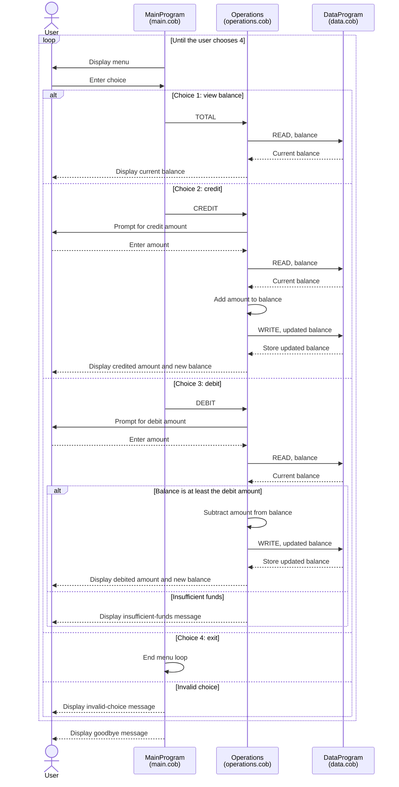

# COBOL Account Management Program

This directory documents the COBOL account-management example in `src/cobol`.
The program provides a menu to view one account balance, credit the account,
debit the account, or exit. Although this may be used as a student-account
exercise, the current implementation does not store student names, IDs, or
separate balances for multiple students.

## COBOL files

### `src/cobol/main.cob` — `MainProgram`

Entry point and user interface. `MAIN-LOGIC` repeatedly displays the menu,
accepts a numeric choice, and dispatches requests to `Operations`:

- `1` sends `TOTAL ` to display the balance.
- `2` sends `CREDIT` to add funds.
- `3` sends `DEBIT ` to subtract funds.
- `4` exits the loop and stops the program.
- Other choices display an invalid-choice message and return to the menu.

### `src/cobol/operations.cob` — `Operations`

Handles account actions based on the operation passed by `MainProgram`.

- `TOTAL ` requests the balance from `DataProgram` and displays it.
- `CREDIT` accepts an amount, reads the current balance, adds the amount,
  writes the new balance, and displays it.
- `DEBIT ` accepts an amount, reads the current balance, and subtracts and
  saves the amount only when the balance is greater than or equal to it.
  Otherwise it displays an insufficient-funds message and leaves the balance
  unchanged.

### `src/cobol/data.cob` — `DataProgram`

Stores and retrieves the account balance. The `READ` operation copies its
`STORAGE-BALANCE` to the caller's balance field; `WRITE` replaces
`STORAGE-BALANCE` with the supplied value. The starting balance is `1000.00`.
This storage is in working memory, so changes are lost when the program exits.

## Student-account business rules and behavior

- The program maintains one shared account balance; there are no student
  profiles, account selection, transaction history, or persistent records.
- A new run starts with a balance of `1000.00`.
- Credits add the entered amount without a maximum-balance check.
- A debit is accepted when the current balance is at least the entered amount.
  A debit that exceeds the balance is rejected without changing the balance;
  overdrafts are not allowed by this check.
- Amount fields use `PIC 9(6)V99`, representing up to six integer digits and
  two decimal places. The implied decimal point is not displayed by these
  fields.
- The code does not validate that entered amounts are positive or otherwise
  valid business amounts. It also does not define student-specific fees,
  minimum balances, or other student-account policies.

## Application data flow

